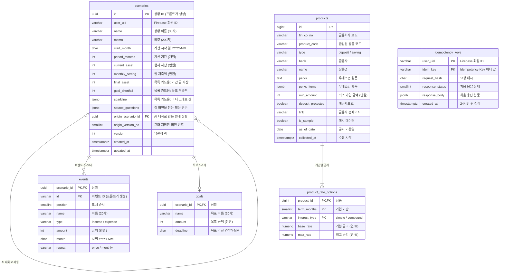

# ERD (v0.1)

# WHAT IF ERD

| 항목 | 내용 |
| --- | --- |
| 버전 | v0.1 (2026-11-15, 첫 작성. 로그인 필수·상황 삭제·이름 변경·회원 탈퇴 포함 반영) |
| DB | PostgreSQL (Neon 무료로 시작) / JPA / Flyway |
| 문자셋 | UTF-8 |
| 시간 | 모든 시각 컬럼은 `timestamptz`. 응답은 KST(`+09:00`)로 내보냄 |
| 금액 | 모든 금액 컬럼은 만원 단위 정수 |
| 범위 | MVP. 로그인은 Firebase Authentication(이메일·비밀번호, Google)이 맡아서 회원 테이블이 없음 |

## 1. 관계도



## 2. 테이블 목록

| 테이블 | 설명 | 비고 |
| --- | --- | --- |
| `scenarios` | 저장한 상황 | 대화 중 고른 버전 하나가 한 행. 나머지 버전은 저장하지 않음 |
| `events` | 상황의 예정 수입·지출 | 상황을 지우면 같이 삭제 |
| `goals` | 상황의 목표 | 상황당 0~1개. 상황을 지우면 같이 삭제 |
| `idempotency_keys` | 저장 요청 중복 방지 기록 | 같은 요청이 두 번 와도 한 번만 저장. 24시간 뒤 정리 |
| `products` | 공시 예·적금 상품 | 하루 한 번 금감원 데이터를 복사. 상황과 연결 없음 |
| `product_rate_options` | 상품의 기간별 금리 | 상품을 지우면 같이 삭제 |

회원 테이블은 없어요. 로그인 정보(이메일, 비밀번호, 닉네임)는 Firebase Authentication이 보관하고, 서버는 Firebase 회원 ID(`user_uid`)만 써요.

## 3. 테이블 명세

### 3-1. `scenarios` — 저장한 상황

| 컬럼 | 타입 | NULL | 기본값 | 키 | 설명 |
| --- | --- | --- | --- | --- | --- |
| `id` | uuid | N |  | PK | 상황 ID. 프론트가 UUID로 생성 (체험 모드에서 가져올 때 중복 방지) |
| `user_uid` | varchar(128) | N |  |  | Firebase 회원 ID (로그인 토큰의 `sub`) |
| `name` | varchar(30) | N |  |  | 상황 이름. 앞뒤 공백 제거 후 1~30자, 중복 허용 |
| `memo` | varchar(200) | Y |  |  | 메모. 빈 문자열은 null로 저장 |
| `start_month` | char(7) | N |  |  | 계산 시작 월 `YYYY-MM`. 열 때 이 값으로 다시 계산 |
| `period_months` | integer | N |  |  | 계산 기간 6~120개월 |
| `current_asset` | integer | N |  |  | 현재 자산 0~100,000만원 |
| `monthly_saving` | integer | N |  |  | 월 저축액 0~1,000만원. 슬라이더로 바꾼 값 포함 |
| `final_asset` | integer | N |  |  | 목록 카드용 요약. 기간 끝 자산 (음수 가능). 저장 시 서버가 계산 |
| `goal_shortfall` | integer | Y |  |  | 목록 카드용 요약. 목표 부족액 (양수 부족, 음수 초과). 목표 없으면 null |
| `sparkline` | jsonb | N |  |  | 목록 카드용 요약. 월별 자산 숫자 배열 (최대 121개) |
| `source_questions` | jsonb | N | `'[]'` |  | 저장한 버전을 만든 질문 원문 배열 |
| `origin_scenario_id` | uuid | Y |  | FK | 저장한 상황을 열어 AI 대화로 만든 버전을 새 상황으로 저장했을 때 원래 상황 |
| `origin_version_no` | smallint | Y |  |  | 그때 저장한 버전 번호 (2~10) |
| `version` | integer | N | 0 |  | 낙관적 락. 덮어쓰기·이름 변경마다 1 증가 |
| `created_at` | timestamptz | N | `now()` |  | 생성 시각 |
| `updated_at` | timestamptz | N | `now()` |  | 수정 시각. 목록 정렬 기준 |
- 인덱스 `idx_scenarios_user_updated` (user_uid, updated_at DESC)
- 외래키 `origin_scenario_id` → `scenarios.id` (삭제 시 SET NULL)

### 3-2. `events` — 예정 수입·지출

| 컬럼 | 타입 | NULL | 기본값 | 키 | 설명 |
| --- | --- | --- | --- | --- | --- |
| `scenario_id` | uuid | N |  | PK, FK | 상황 ID |
| `id` | varchar(64) | N |  | PK | 이벤트 ID. 프론트가 생성. AI 대화의 수정·삭제가 이 값을 참조 |
| `position` | smallint | N |  |  | 목록 표시 순서. 요청 배열 순서대로 0부터 |
| `name` | varchar(20) | N |  |  | 이름. 앞뒤 공백 제거 후 1~20자 |
| `type` | varchar(10) | N |  |  | `income` 수입 / `expense` 지출 |
| `amount` | integer | N |  |  | 금액 1~100,000만원. 항상 양수, 부호는 `type`으로 구분 |
| `month` | char(7) | N |  |  | 시점 `YYYY-MM`. 계산 기간 안인지는 서버에서 검사 |
| `repeat` | varchar(10) | N |  |  | `once` 한 번 / `monthly` 지정한 달부터 기간 끝까지 |
- 외래키 `scenario_id` → `scenarios.id` (삭제 시 CASCADE)

### 3-3. `goals` — 목표

| 컬럼 | 타입 | NULL | 기본값 | 키 | 설명 |
| --- | --- | --- | --- | --- | --- |
| `scenario_id` | uuid | N |  | PK, FK | 상황 ID. 상황당 목표 0~1개라 PK로 사용 |
| `name` | varchar(20) | N |  |  | 목표 이름 1~20자. 비어 있으면 서버가 "내 목표"로 채움 |
| `amount` | integer | N |  |  | 목표 금액 1~1,000,000만원 |
| `deadline` | char(7) | N |  |  | 목표 기한 `YYYY-MM`. 시작 다음 달~기간 끝 (서버에서 검사) |
- 외래키 `scenario_id` → `scenarios.id` (삭제 시 CASCADE)

### 3-4. `idempotency_keys` — 저장 요청 중복 방지

> 저장 버튼을 두 번 누르거나 네트워크가 끊겨 다시 보내도 상황이 하나만 생기게 하는 기록
> 

| 컬럼 | 타입 | NULL | 기본값 | 키 | 설명 |
| --- | --- | --- | --- | --- | --- |
| `user_uid` | varchar(128) | N |  | PK | Firebase 회원 ID |
| `idem_key` | varchar(64) | N |  | PK | `Idempotency-Key` 헤더 값 (프론트가 만든 UUID) |
| `request_hash` | char(64) | N |  |  | 메서드 + 경로 + 본문의 SHA-256. 같은 키에 다른 요청이 오면 거절 |
| `response_status` | smallint | N |  |  | 처음 응답의 HTTP 상태 |
| `response_body` | jsonb | Y |  |  | 처음 응답 본문 |
| `created_at` | timestamptz | N | `now()` |  | 기록 시각. 24시간 뒤 정리 |
- 인덱스 `idx_idempotency_keys_created` (created_at)

### 3-5. `products` — 공시 예·적금 상품

> 금감원 '금융상품한눈에' 데이터를 하루 한 번 복사. 필드 이름은 인증키로 실제 응답을 받아 본 뒤 확정 (미확인)
> 

| 컬럼 | 타입 | NULL | 기본값 | 키 | 설명 |
| --- | --- | --- | --- | --- | --- |
| `id` | bigserial | N |  | PK | 상품 ID |
| `fin_co_no` | varchar(20) | N |  | UK | 금융회사 코드 |
| `product_code` | varchar(50) | N |  | UK | 금감원 상품 코드 |
| `type` | varchar(10) | N |  |  | `deposit` 정기예금 / `saving` 적금 |
| `bank` | varchar(100) | N |  |  | 금융사 이름 |
| `name` | varchar(200) | N |  |  | 상품명 |
| `join_target` | text | Y |  |  | 가입 대상 |
| `join_ways` | varchar(100) | Y |  |  | 가입 방법 (영업점, 인터넷, 스마트폰 등) |
| `min_amount` | integer | Y |  |  | 최소 가입 금액(만원). 공시 원문에서 코드로 읽은 값, 못 읽으면 null |
| `max_limit` | integer | Y |  |  | 가입 한도(만원). null이면 한도 없음 |
| `deposit_protected` | boolean | Y |  |  | 예금자보호 여부. 예금보험공사 데이터와 맞을 때만 값, 아니면 null |
| `perks` | text | Y |  |  | 우대조건 원문 |
| `perks_items` | jsonb | Y |  |  | 우대조건 항목 `[{"condition": "급여이체", "rate": 0.2}]`. 우대조건 없으면 `[]`, 못 읽으면 null |
| `etc_note` | text | Y |  |  | 기타 유의사항 원문 |
| `maturity_rate_note` | text | Y |  |  | 만기 후 이율 |
| `link` | varchar(500) | Y |  |  | 금융사 홈페이지 (상품 페이지 주소는 공시에 없음) |
| `is_sample` | boolean | N | false |  | 개발·데모용 예시 데이터 |
| `as_of_date` | date | N |  |  | 공시 기준일 |
| `collected_at` | timestamptz | N |  |  | 수집 시각 |
- 유니크 `uk_products_code` (fin_co_no, product_code) → 수집할 때 upsert 기준

### 3-6. `product_rate_options` — 기간별 금리

| 컬럼 | 타입 | NULL | 기본값 | 키 | 설명 |
| --- | --- | --- | --- | --- | --- |
| `product_id` | bigint | N |  | PK, FK | 상품 ID |
| `term_months` | smallint | N |  | PK | 가입 기간(개월) |
| `interest_type` | varchar(10) | N |  | PK | `simple` 단리 / `compound` 복리 |
| `base_rate` | numeric(5,2) | N |  |  | 기본 금리 (연 %) |
| `max_rate` | numeric(5,2) | N |  |  | 최고 금리 (연 %) |
- 인덱스 `idx_product_rate_options_term` (term_months, max_rate DESC)
- 외래키 `product_id` → `products.id` (삭제 시 CASCADE)

## 4. 설계 메모

| 주제 | 내용 |
| --- | --- |
| 로그인 | Firebase Authentication(이메일·비밀번호, Google). 서버는 로그인 토큰만 검증해 `user_uid`를 꺼냄. 이메일 중복 가입은 Firebase가 막음 |
| 닉네임 | Firebase 프로필 `displayName`에 저장 (중복 허용). Google 로그인은 Google 이름이 자동으로 들어감. 서버 DB에 없음 |
| 버전 저장 | 대화 중 버전(V1~V10)은 브라우저에만 있음. 저장하면 고른 버전 하나가 `scenarios` 한 행이 되고 나머지는 버림 (정책표 10장) |
| 요약 컬럼 | `final_asset`, `goal_shortfall`, `sparkline`은 프론트가 보낸 결과를 믿지 않고 저장할 때 서버가 조건으로 다시 계산해 채움 |
| 열기 | 저장한 조건으로 다시 계산해서 돌려줌. 계산 결과 전체는 저장하지 않음 |
| AI로 만든 상황 표시 | 디자인 W03 카드 "상황 1에서 AI 대화로 생성". 원래 상황을 지우면 `origin_scenario_id`가 null이 되고 일반 요약 줄로 돌아감 |
| 덮어쓰기 | `version`이 열 때 값과 다르면 거절 (다른 탭·기기에서 먼저 바꾼 경우). 이벤트는 모두 지우고 새로 넣음. 한 트랜잭션 |
| 저장 중복 | 상황·이벤트·목표·멱등성 키를 한 트랜잭션에서 저장. 같은 키가 동시에 오면 두 번째는 첫 번째가 끝날 때까지 기다렸다가 저장된 응답을 돌려받음 |
| 한도 | 계정당 상황 20개, 상황당 이벤트 50개 (백엔드 제안, PM 확인 중). DB가 아니라 서버 한 곳에서 검사 |
| 범위 검사 | 금액·기간 범위는 DB 제약과 서버 검증 둘 다. 이벤트 시점·목표 기한이 계산 기간 안인지는 시작 월에 따라 달라서 서버에서만 검사 |
| 금액 크기 | 가장 큰 경우(이벤트 50개 모두 매달 100,000만원, 120개월)도 약 6억(만원)이라 `integer` 범위 안. 계산은 `long`으로 |
| 탈퇴 | `DELETE /api/v1/users/me`가 `user_uid`로 상황과 멱등성 키 삭제. 이벤트·목표는 CASCADE. 프론트는 그 뒤 Firebase 계정 삭제 |
| 상품 우대조건 | 수집할 때 원문을 코드(정규식)로 읽어 `perks_items`에 저장. AI로 읽지 않음 (AI는 금리 숫자를 만들지 않는다는 원칙). 못 읽으면 화면에 원문 표시 |
| 예금자보호 | 예금보험공사 데이터와 상품이 맞을 때만 값. null이면 화면에 "금융사에서 확인하세요" |
| 시간대 | `timestamptz`로 저장하고 응답할 때 `+09:00`으로 바꿈. 서버(JVM) 시간대는 `Asia/Seoul` |

## 5. 배치 작업

| 시각 (KST) | 작업 |
| --- | --- |
| 매일 1회 (GitHub Actions가 호출) | 금감원 상품 수집 → `products`, `product_rate_options` upsert. 같은 호출 끝에 24시간 지난 `idempotency_keys` 삭제 |

Cloud Run은 요청이 없으면 꺼지므로 서버 안 스케줄러를 쓰지 않고, GitHub Actions cron이 수집 API를 비밀 토큰과 함께 불러요.

## 6. 확정 사항과 나중에 추가할 것

| 항목 | 결정 | ERD 반영 |
| --- | --- | --- |
| 로그인 | 필수. Firebase(이메일·Google) (11/15) | 회원 테이블 없음, `user_uid`만 |
| 닉네임 | 중복 허용 (11/15) | Firebase 프로필, DB 없음 |
| 버전 저장 | 고른 버전 하나만 (정책표 10장) | 버전 테이블 없음 |
| 상황 삭제·이름 변경 | MVP 포함 (11/15) | 컬럼 변경 없음 |
| 회원 탈퇴 | MVP 포함, 저장한 상황 즉시 삭제 (11/15) | `user_uid`로 일괄 삭제 |
| 상품 카드 항목 | 원문을 코드로 읽어 채움, 못 읽으면 원문 (11/15) | `perks_items`, `min_amount`, `deposit_protected`, `etc_note` |
| 상황 20개·이벤트 50개 상한 | 백엔드 제안, PM 확인 중 | 컬럼 없음 (서버 설정값) |
| 목표를 끈 채 저장 | 미정 | 값을 남기기로 하면 `goals.enabled` 추가 |
| 입력 금액 암호화 | 미정 (정책표 14장) | 암호화하면 금액 컬럼 타입이 바뀜 |

## 부록. DDL (PostgreSQL)

```sql
-- WHAT IF ERD - PostgreSQL / v0.1 (2026-11-15)
-- V1__init.sql

-- 저장한 상황
CREATE TABLE scenarios (
    id                 uuid         PRIMARY KEY,
    user_uid           varchar(128) NOT NULL,
    name               varchar(30)  NOT NULL CHECK (char_length(btrim(name)) >= 1),
    memo               varchar(200),
    start_month        char(7)      NOT NULL CHECK (start_month ~ '^[0-9]{4}-(0[1-9]|1[0-2])$'),
    period_months      integer      NOT NULL CHECK (period_months BETWEEN 6 AND 120),
    current_asset      integer      NOT NULL CHECK (current_asset BETWEEN 0 AND 100000),
    monthly_saving     integer      NOT NULL CHECK (monthly_saving BETWEEN 0 AND 1000),
    final_asset        integer      NOT NULL,
    goal_shortfall     integer,
    sparkline          jsonb        NOT NULL,
    source_questions   jsonb        NOT NULL DEFAULT '[]'::jsonb,
    origin_scenario_id uuid         REFERENCES scenarios (id) ON DELETE SET NULL,
    origin_version_no  smallint     CHECK (origin_version_no BETWEEN 2 AND 10),
    version            integer      NOT NULL DEFAULT 0,
    created_at         timestamptz  NOT NULL DEFAULT now(),
    updated_at         timestamptz  NOT NULL DEFAULT now()
);

CREATE INDEX idx_scenarios_user_updated ON scenarios (user_uid, updated_at DESC);

-- 예정 수입·지출
CREATE TABLE events (
    scenario_id uuid        NOT NULL REFERENCES scenarios (id) ON DELETE CASCADE,
    id          varchar(64) NOT NULL,
    position    smallint    NOT NULL,
    name        varchar(20) NOT NULL CHECK (char_length(btrim(name)) >= 1),
    type        varchar(10) NOT NULL CHECK (type IN ('income', 'expense')),
    amount      integer     NOT NULL CHECK (amount BETWEEN 1 AND 100000),
    month       char(7)     NOT NULL CHECK (month ~ '^[0-9]{4}-(0[1-9]|1[0-2])$'),
    repeat      varchar(10) NOT NULL CHECK (repeat IN ('once', 'monthly')),
    PRIMARY KEY (scenario_id, id)
);

-- 목표
CREATE TABLE goals (
    scenario_id uuid        PRIMARY KEY REFERENCES scenarios (id) ON DELETE CASCADE,
    name        varchar(20) NOT NULL CHECK (char_length(btrim(name)) >= 1),
    amount      integer     NOT NULL CHECK (amount BETWEEN 1 AND 1000000),
    deadline    char(7)     NOT NULL CHECK (deadline ~ '^[0-9]{4}-(0[1-9]|1[0-2])$')
);

-- 저장 요청 중복 방지
CREATE TABLE idempotency_keys (
    user_uid        varchar(128) NOT NULL,
    idem_key        varchar(64)  NOT NULL,
    request_hash    char(64)     NOT NULL,
    response_status smallint     NOT NULL,
    response_body   jsonb,
    created_at      timestamptz  NOT NULL DEFAULT now(),
    PRIMARY KEY (user_uid, idem_key)
);

CREATE INDEX idx_idempotency_keys_created ON idempotency_keys (created_at);

-- 공시 상품 : 금감원 응답 확인 후 V2 마이그레이션으로 분리 (미확인)
CREATE TABLE products (
    id                 bigserial    PRIMARY KEY,
    fin_co_no          varchar(20)  NOT NULL,
    product_code       varchar(50)  NOT NULL,
    type               varchar(10)  NOT NULL CHECK (type IN ('deposit', 'saving')),
    bank               varchar(100) NOT NULL,
    name               varchar(200) NOT NULL,
    join_target        text,
    join_ways          varchar(100),
    min_amount         integer,
    max_limit          integer,
    deposit_protected  boolean,
    perks              text,
    perks_items        jsonb,
    etc_note           text,
    maturity_rate_note text,
    link               varchar(500),
    is_sample          boolean      NOT NULL DEFAULT false,
    as_of_date         date         NOT NULL,
    collected_at       timestamptz  NOT NULL,
    CONSTRAINT uk_products_code UNIQUE (fin_co_no, product_code)
);

-- 기간별 금리
CREATE TABLE product_rate_options (
    product_id    bigint       NOT NULL REFERENCES products (id) ON DELETE CASCADE,
    term_months   smallint     NOT NULL CHECK (term_months > 0),
    interest_type varchar(10)  NOT NULL CHECK (interest_type IN ('simple', 'compound')),
    base_rate     numeric(5,2) NOT NULL,
    max_rate      numeric(5,2) NOT NULL,
    PRIMARY KEY (product_id, term_months, interest_type)
);

CREATE INDEX idx_product_rate_options_term ON product_rate_options (term_months, max_rate DESC);
```
